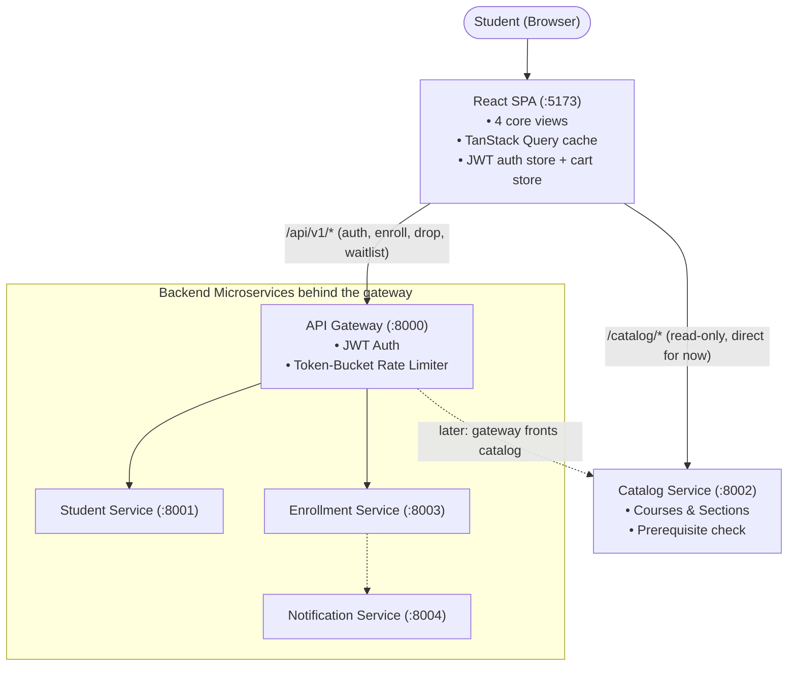

# Student Course Registration System — Frontend (Web Client)

> **Course**: 13016228 Software Design and Architecture (KMITL)
> **Tech Stack**: React 19 / TypeScript / Vite / React Router / TanStack Query / Tailwind CSS / shadcn/ui
> **Package & Toolchain Manager**: **npm** (bundled with Node.js 22+)
> **Backend Repo**: [course_registration_microservice](https://github.com/Tock15/course_registration_microservice)
> **Backend API Cheat Sheet**: [`docs/FRONTEND_GUIDE.md`](docs/FRONTEND_GUIDE.md) (written by the backend team)

---

## 1. System Architecture & Backend Integration

The frontend is a single-page application (SPA) with **two backend entry points** today:

- **API Gateway (`:8000`)**: login, enrollment, drop, waitlist claim. It is the only place where JWTs are verified.
- **Catalog Service (`:8002`)**: read-only course/section data and the prerequisite check. It is live now and is called directly until the gateway fronts it.

The browser never calls these ports itself. It calls same-origin paths (`/api/...` and `/catalog/...`) and the Vite dev server (also used by `npm run preview`) forwards them. That means **no CORS setup is needed**.



### Port Matrix (Frontend Perspective)

| Component                | Port   | Frontend Usage                                                                                          |
| ------------------------ | ------ | ------------------------------------------------------------------------------------------------------- |
| **Web (Vite dev)**       | `5173` | Dev server with hot reload; proxies `/api` to the gateway and `/catalog` to the catalog service.        |
| **Web (`vite preview`)** | `4173` | Serves the production build locally for demos; same `/api` and `/catalog` proxies as dev.               |
| **API Gateway**          | `8000` | Login, enroll, drop, waitlist claim (and everything else once proxied).                                 |
| **Catalog Service**      | `8002` | **Live now.** Courses, sections with live seat counts, prerequisite validation.                         |
| **Student Service**      | `8001` | Profile and completed courses (reached via gateway). Path to be confirmed.                              |
| **Enrollment Service**   | `8003` | **Upcoming.** Enroll, drop, waitlist claim (reached via gateway).                                       |
| **Notification Service** | `8004` | Optional alerts (reached via gateway).                                                                  |

> Each backend service exposes Swagger at `http://localhost:<port>/docs`. Treat it as the source of truth for request/response shapes.

---

## 2. UI Scope: The 4 Required Views

The project requirements define a student portal with four core views. No graph drawing is required: the prerequisite engine runs on the backend and the UI only shows `MET` or `MISSING`.

| # | View                                  | What the Student Does                                                                                   | Data It Needs                                                                                       | Backend Status                       |
| - | ------------------------------------- | ------------------------------------------------------------------------------------------------------- | --------------------------------------------------------------------------------------------------- | ------------------------------------ |
| 1 | **Course Catalog & Section Search**   | Search by code/title, filter by department and day, "open sections only"; see live seat badges.         | `GET /courses`, `GET /sections`                                                                     | ✅ Live                              |
| 2 | **Weekly Timetable Preview**          | See a Mon–Fri, 08:00–18:00 grid. Blue = enrolled, amber = in cart.                                      | Sections (live), cart (client state), **my enrollments (❓)**                                        | ❓ Needs "my enrollments"            |
| 3 | **Cart & Pre-Flight Validation**      | Review selected sections, see credits vs the 22 cap, prereqs `MET`/`MISSING`, clashes; Confirm & Enroll. | `POST /validate-prereqs`, **student's completed courses (❓)**, `POST /api/v1/enrollments`            | ✅ Prereq check live, 🔜 Enroll      |
| 4 | **Registered Courses & Waitlist**     | See enrolled courses with Drop; see waitlist positions and claim an offered seat.                        | **my enrollments (❓)**, **waitlist position (❓)**, `POST /api/v1/drops`, `POST /api/v1/waitlist/claim` | 🔜 Drop/claim, ❓ the lists          |

---

## 3. Quickstart for Team Members (One-Time Setup)

**Prerequisites**: Node.js 22+ (npm is included; check with `node -v` and `npm -v`).

### Step 1: Clone & Install Dependencies

```
git clone https://github.com/F3ll4s/course_registration_microservice_Frontend.git
cd course_registration_microservice_Frontend

# Installs the versions pinned in package-lock.json
npm install
```

### Step 2: Configure Environment

```
cp .env.example .env
```

(On Windows you can also copy the file and rename the copy to `.env` in your editor.)

| Variable                 | Default                 | Purpose                                                                                   |
| ------------------------ | ----------------------- | ----------------------------------------------------------------------------------------- |
| `VITE_API_BASE_URL`      | `/api/v1`               | Base path for gateway calls (auth, enrollments, drops, waitlist).                         |
| `VITE_CATALOG_BASE_URL`  | `/catalog`              | Base path for catalog calls. Change to `/api/v1` once the gateway fronts the catalog.     |
| `VITE_GATEWAY_URL`       | `http://localhost:8000` | Dev proxy target for `/api` (used only by `vite.config.ts`).                              |
| `VITE_CATALOG_URL`       | `http://localhost:8002` | Dev proxy target for `/catalog` (used only by `vite.config.ts`).                          |

### Step 3: Verify Setup

```
npm run typecheck && npm test
```

The type-check should pass, and tests run without any backend because the API is mocked with MSW. (On a brand-new scaffold there are no tests yet and `npm test` still exits cleanly.)

---

## 4. How to Run Locally

```
# Option A: everything real (gateway :8000 and catalog :8002 must be running)
npm run dev

# Option B: hybrid. Real catalog, mocked gateway (login, enroll, drop, waitlist).
# Best option while the enrollment service is not connected yet.
npm run dev:hybrid

# Option C: fully mocked backend (MSW), no Python needed
npm run dev:mock
```

To start the real catalog service, run this from the backend repo (see its README, section 3, for the other services):

```
uv run uvicorn catalog_service.main:app --port 8002 --reload
```

Open `http://localhost:5173`.

To rehearse the production build, run `npm run build && npm run preview` (serves on `http://localhost:4173` with the same proxies).

- **Mock / hybrid login**: any `student_id` / `password` works.
- **Real gateway login**: ask the backend team for seeded credentials (the backend docs use `STU_001` as an example ID).

### Available Scripts

| Script               | What it does                                                       |
| -------------------- | ------------------------------------------------------------------ |
| `npm run dev`        | Vite dev server against the real gateway and catalog.              |
| `npm run dev:hybrid` | MSW mocks only gateway routes (`/api/v1/*`); `/catalog/*` is real. |
| `npm run dev:mock`   | MSW mocks everything.                                              |
| `npm run build`      | Type-check and produce the production build.                       |
| `npm run preview`    | Serve the production build locally (port 4173).                    |
| `npm run typecheck`  | TypeScript check only.                                             |
| `npm run lint`       | ESLint check (Vite template config).                               |
| `npm run lint:fix`   | ESLint auto-fix.                                                   |
| `npm test`           | Vitest unit/component tests (single run).                          |
| `npm run test:e2e`   | Playwright end-to-end tests (needs backend or mock).               |

---

## 5. Backend API Contract (What the UI Depends On)

**Legend**: ✅ confirmed by the backend team (live or documented) · 🔜 path and body confirmed, service not connected yet · ❓ not defined yet, needs an answer from the backend team.

### Catalog Service (base `/catalog` → `http://localhost:8002`)

| Feature         | Method & Path                                                          | Request                                                          | Response                                                                                                                   | Status |
| --------------- | ---------------------------------------------------------------------- | ---------------------------------------------------------------- | -------------------------------------------------------------------------------------------------------------------------- | ------ |
| List courses    | `GET /courses?search=&department=`                                     | optional query params                                            | `Course[]` = `{code, title, credits, prerequisites[]}`                                                                     | ✅     |
| List sections   | `GET /sections?course_code=&day=&open_only=`                           | optional query params (`day` = `MON`..`FRI`, `open_only` = bool) | `Section[]` = `{id, course_code, section_number, capacity, enrolled_count, schedule_days[], start_time, end_time, room, instructor}` | ✅     |
| Validate prereqs | `POST /validate-prereqs`                                              | `{student_id, course_code, completed_courses[]}`                 | `{is_valid, missing_prereqs[], message}`                                                                                   | ✅     |

### Gateway (base `/api/v1` → `http://localhost:8000`)

| Feature           | Method & Path                    | Request                  | Response                                                       | Status |
| ----------------- | -------------------------------- | ------------------------ | -------------------------------------------------------------- | ------ |
| Login             | `POST /auth/login`               | `{student_id, password}` | `200 {access_token, token_type: "bearer"}`                     | ✅     |
| Enroll            | `POST /enrollments`              | `{section_id}`           | `201 {status: "ENROLLED"}` or `409 {status: "WAITLISTED"}`     | ✅     |
| Drop              | `POST /drops`                    | `{section_id}`           | ❓ (response shape not documented)                             | 🔜     |
| Claim waitlist    | `POST /waitlist/claim`           | `{offer_id}`             | `CLAIMED` or `EXPIRED_OR_ALREADY_CLAIMED`                      | 🔜     |

### Requested from the Backend Team (Blocking Views 2, 3 and 4)

| # | What the UI Needs                                                                                              | Needed By                                                                  |
| - | -------------------------------------------------------------------------------------------------------------- | -------------------------------------------------------------------------- |
| 1 | The student's **completed courses** (e.g. in `GET /students/{id}`) and the gateway path to reach it.           | View 3: `validate-prereqs` requires `completed_courses` in the body.       |
| 2 | **"My enrollments"**: the student's enrolled sections with status (e.g. `GET /enrollments/me`).                 | Views 2, 3 and 4: timetable, credit total, registered table.               |
| 3 | **"My waitlist"**: for each entry `offer_id`, `section_id`, `position`, `status`, `expires_at`.                  | View 4: queue position, claim button, countdown.                           |
| 4 | A **`department`** field on `Course` (the filter exists, but the sample response does not include it).         | View 1: department dropdown options and display.                           |
| 5 | Will the gateway front the catalog (and if so, at which path)? Does it then require the JWT?                   | Decides whether `VITE_CATALOG_BASE_URL` stays `/catalog` or becomes `/api/v1`. |

### Rules the UI Must Respect

1. **`409 + WAITLISTED` is a normal outcome, not an error.** Show "Section full, you're on the waitlist", not a red error toast.
2. **Identity comes from the JWT.** Never send `student_id` in enroll, drop or claim bodies. The one exception today is `POST /validate-prereqs`, which takes `student_id` and `completed_courses` in the body because the catalog service has no auth.
3. **`401` means the token is missing, invalid or expired.** Clear the auth store and redirect to `/login`.
4. **Rate limiting**: the gateway has a token-bucket limiter (built against button spam). Disable action buttons while a request is pending, show a friendly message on `429`, and submit "Confirm & Enroll" **one section at a time**.
5. **Seat badge**: `enrolled_count < capacity` shows green `48/50 OPEN` with **Enroll / Add to Cart**. Otherwise red `50/50 FULL` with **Join Waitlist**. Join Waitlist calls the same enroll endpoint, because the backend answers a full section with `409 WAITLISTED` (assumption: confirm with the backend team).
6. **Sections do not carry `title` or `credits`.** Join `Section.course_code` with `Course.code` on the client.
7. **Formats**: days are `MON`..`FRI`; times are 24-hour `"HH:MM"` strings.
8. **The cart is client-side state.** The backend does not expose a "staged" endpoint. The cart lives in a Zustand store (persisted to `sessionStorage`) and "Confirm & Enroll" submits each section.
9. **Credit cap is 22** and counts already-enrolled credits plus the cart. Show `18 / 22 Credits` and block Confirm when over.
10. **Waitlist offers expire.** Show a countdown, but the server is authoritative. Always handle `EXPIRED_OR_ALREADY_CLAIMED`.
11. **Enrollment lifecycle**: `STAGED -> OFFERED -> ENROLLED -> DROPPED`. A request can also come back `WAITLISTED` or `REJECTED` (with a `detail` message). Map every status to a label and badge in one place (`src/features/enrollment/status.ts`).

---

## 6. Authentication Flow (Client Side)

1. Student submits `student_id` + `password` on `/login`, which calls `POST /api/v1/auth/login`.
2. The `access_token` (JWT, HS256) is decoded for `sub` (student id) and `exp`, then stored in the Zustand auth store (persisted to `sessionStorage`).
3. `src/api/client.ts` attaches `Authorization: Bearer <token>` to requests when a token exists.
4. `ProtectedRoute` redirects unauthenticated users to `/login` and remembers the page they wanted.
5. On `401` or when `exp` has passed, the store logs out and the user lands on `/login`.

> There is no refresh-token endpoint in the backend docs. When the token expires the student logs in again.
> The catalog service (`:8002`) is called without auth today.

---

## 7. Project Structure

```
course_registration_microservice_Frontend/
├── package.json                    # Scripts + dependencies (managed via npm)
├── package-lock.json               # Deterministic lockfile
├── vite.config.ts                  # Dev proxy, @/ alias, Vitest config
├── tsconfig.json / tsconfig.app.json / tsconfig.node.json
├── eslint.config.js                # Vite template + override for shadcn/ui files
├── components.json                 # shadcn/ui config
├── index.html                      # Vite entry page
├── .env.example                    # Copy to .env for local overrides
├── .env.test                       # Absolute base URLs for Vitest
├── .gitignore
├── README.md
├── TECHSTACK_AND_IMPLEMENTATION.md
│
├── docs/
│   └── FRONTEND_GUIDE.md           # Catalog API cheat sheet from the backend team
│
├── public/
│   ├── favicon.svg
│   ├── icons.svg
│   └── mockServiceWorker.js        # Generated by `msw init` (do not edit)
│
└── src/
    ├── main.tsx                    # Starts MSW in `mock` / `hybrid` mode, then renders <App/>
    ├── index.css                   # Tailwind import + shadcn theme variables
    │
    ├── app/
    │   ├── App.tsx                 # Root component (imported by main.tsx)
    │   ├── ProtectedRoute.tsx      # Protection Proxy (client side)
    │   ├── layouts/                # (empty) page shell: navbar + <Outlet/>
    │   ├── provider/               # (empty) QueryClientProvider, Toaster
    │   └── router/
    │       └── AppRouter.tsx       # (empty) route table
    │
    ├── api/                        # Facade over the gateway and the catalog service
    │   ├── client.ts               # fetch wrapper (two bases), ApiError, 401 handling
    │   ├── types.ts                # Shared DTO types (mirror backend schemas)
    │   ├── auth.ts                 # login()
    │   ├── catalog.ts              # getCourses(), getSections(), validatePrereqs()
    │   ├── enrollments.ts          # enroll(), drop(), claimWaitlist()
    │   └── enrollments.test.ts     # enroll() 201 / 409 WAITLISTED
    │
    ├── features/
    │   ├── auth/
    │   │   └── store.ts            # JWT + student id (Zustand, sessionStorage)
    │   ├── catalog/                # View 1
    │   │   ├── useCatalog.ts       # courses + sections, joined on the client
    │   │   ├── SeatBadge.tsx
    │   │   └── seats.ts            # isFull()
    │   ├── timetable/              # View 2
    │   │   └── TimetableBlock.tsx
    │   ├── cart/                   # View 3
    │   │   ├── store.ts            # staged section ids
    │   │   ├── rules.ts            # credit cap, schedule conflict, prereq rules
    │   │   ├── useCartRows.ts
    │   │   ├── usePrereqChecks.ts
    │   │   └── useConfirmCart.ts
    │   └── enrollment/             # View 4
    │       ├── status.ts           # STATUS_UI map
    │       └── useEnroll.ts
    │
    ├── components/ui/              # shadcn/ui primitives (shared)
    │   └── badge.tsx, button.tsx, card.tsx, dialog.tsx, input.tsx, label.tsx, sonner.tsx, table.tsx
    │
    ├── lib/
    │   ├── errors.ts               # toUserMessage(err)
    │   ├── utils.ts                # cn() helper (shadcn)
    │   └── time.ts                 # toMin(), parseServerTime(), useCountdown()
    │
    ├── mocks/
    │   ├── browser.ts              # setupWorker(...handlers)
    │   ├── server.ts               # setupServer(...handlers) for Vitest
    │   └── handlers/
    │       └── auth.ts, catalog.ts, enrollment.ts
    │
    └── test/
        └── setup.ts                # jest-dom matchers, MSW server lifecycle
```

This tree shows the files that exist today. Still to add: the page components for each view (`LoginPage`, `CatalogPage`, `TimetablePage`, `CartPage`, `RegisteredPage` and their sub-components), `api/students.ts` and `api/notifications.ts` (paths not confirmed by the backend yet), the optional `student/` and `notifications/` features, and the Playwright specs in `e2e/`.

Tests live next to the code they cover (for example `src/api/enrollments.test.ts`).

Code is organised **by feature**, not by file type, so each teammate mostly works inside their own folders. See `TECHSTACK_AND_IMPLEMENTATION.md` for the full tree and code samples.

---

## 8. Team Task Breakdown & Assignment Guide (2 Frontend Engineers)

Tasks are split along the four views to avoid merge conflicts.

### Day 1 (Both Teammates, Pair Together)

- [ ] One teammate runs the scaffold (`TECHSTACK_AND_IMPLEMENTATION.md`, section 2) and pushes the baseline to `main`. The other is added as a collaborator and clones it.
- [ ] Copy the backend team's guide to `docs/FRONTEND_GUIDE.md`.
- [ ] Agree on the shared contracts: `src/api/types.ts`, `toMin()` in `src/lib/time.ts`, and the cart store interface (`sectionIds`, `add(id)`, `remove(id)`, `clear()`). Teammate 2 owns the cart, but stubs the store on Day 1 so Teammate 1's "Add to Cart" button works.
- [ ] Send the backend team the "Requested from the Backend Team" list in section 5.

### Teammate 1: Foundation, Auth & View 1 (Catalog)

*Components: `src/app/`, `src/api/{client,catalog}.ts`, `src/features/auth/`, `src/features/catalog/`, `src/mocks/`*

- [ ] Implement `src/api/client.ts` (two bases, `Authorization` header, `ApiError`, 401 handling).
- [ ] Implement `features/auth/store.ts` (Zustand + `sessionStorage`, JWT decode, expiry check) and the `/login` page (React Hook Form + Zod).
- [ ] Implement `ProtectedRoute`, the app shell (logo, academic year, logged-in user) and the 4-tab navigation.
- [ ] Implement the catalog filters: search input (debounced), department dropdown, day dropdown, "Show Only Open Sections" toggle.
- [ ] Join courses and sections on the client and render the section table: course code + title, section number, instructor, days + time, room.
- [ ] Implement the seat badge (`48/50 OPEN` green, `50/50 FULL` red) with **Add to Cart** / **Join Waitlist**; poll sections every ~10 s.
- [ ] Set up MSW with the three modes (`dev`, `dev:hybrid`, `dev:mock`); write handlers for auth and catalog.
- [ ] Stretch: student dashboard and notifications page.

### Teammate 2: Views 2, 3 and 4 (Timetable, Cart, Registered & Waitlist)

*Components: `src/features/{cart,timetable,enrollment}/`, `src/api/enrollments.ts`, `e2e/`*

- [ ] Implement the cart store (persisted to `sessionStorage`) and the cart page with credit counts.
- [ ] Implement the validation rules (`creditCapRule`, `scheduleConflictRule`, `prereqRule`) and the summary bar: `18 / 22 Credits`, `Prereqs: MET` / `MISSING CS102`, `Clashes: NONE` / `Conflict: ...`. Unit-test the rules.
- [ ] Call `POST /validate-prereqs` for each cart course (needs the student's completed courses).
- [ ] Implement **Confirm & Enroll**: disabled when validation fails, submits sections one at a time, shows a per-section result (`ENROLLED` / `WAITLISTED` / `REJECTED`), removes successes from the cart.
- [ ] Implement the weekly timetable grid (Mon–Fri, 08:00–18:00; blue enrolled, amber cart).
- [ ] Implement the Registered Courses table with **Drop Course** (confirm dialog, disabled while pending).
- [ ] Implement the Waitlist table: queue position, claim button, countdown to `expires_at`, handle `EXPIRED_OR_ALREADY_CLAIMED`.
- [ ] Write MSW handlers for enrollment, drop and waitlist (including a full section that returns `409`).
- [ ] Write Playwright E2E: browse -> add to cart -> confirm -> timetable shows the class -> drop; plus a waitlist scenario.

### Shared Rules

- `src/components/ui/` is shared. Add components via `npx shadcn@latest add <name>` in their own small PR; do not hand-edit each other's pages.
- Each teammate owns the MSW handlers for their own features (`src/mocks/handlers/<feature>.ts`).
- `src/api/types.ts` and the cart store interface need a quick heads-up to the other teammate before they change.

---

## 9. Frontend Patterns Mapping (For Course Defense)

> Adjust this table to match what you actually implement before the defense.

| Design Pattern       | Location                                                  | Architectural Purpose                                                                                                         |
| -------------------- | --------------------------------------------------------- | ----------------------------------------------------------------------------------------------------------------------------- |
| **Facade / Adapter** | `src/api/*`                                               | UI components never build URLs or parse raw HTTP. They call typed functions like `getSections()` and `enroll(sectionId)`.     |
| **Protection Proxy** | `src/app/ProtectedRoute.tsx` & `src/api/client.ts`        | Client-side guard: blocks protected pages without a token and handles `401` centrally.                                        |
| **Observer**         | TanStack Query subscriptions                              | Components subscribe to cached server state; seat counts re-render as polling brings new data.                                |
| **State**            | `src/features/enrollment/status.ts`                       | One map from backend status (`ENROLLED`, `WAITLISTED`, ...) to label, color and allowed actions.                              |
| **Strategy**         | `src/features/cart/rules.ts` & `src/lib/errors.ts`        | Pluggable pre-flight rules (credit cap, schedule conflict, prerequisites), mirroring the backend's `ValidationStrategy`.      |

---

## 10. Code Quality & Standards

Before committing code or opening a pull request, run the following:

```
# 1. Check lint rules (ESLint)
npm run lint

# 2. Automatically fix what ESLint can
npm run lint:fix

# 3. Type-check and run all automated tests
npm run typecheck && npm test
```

### Git Workflow

- Do not commit directly to `main` (you can enforce this under GitHub **Settings -> Branches** if your plan allows it). Work on branches named `feat/<short-name>`, `fix/<short-name>` or `chore/<short-name>`.
- Open a pull request for every change and get one review from the other frontend teammate.
- Use [Conventional Commits](https://www.conventionalcommits.org/) (`feat: add seat badge`, `fix: handle 409 on enroll`).
- Never commit `.env`. Only `.env.example` is tracked.
